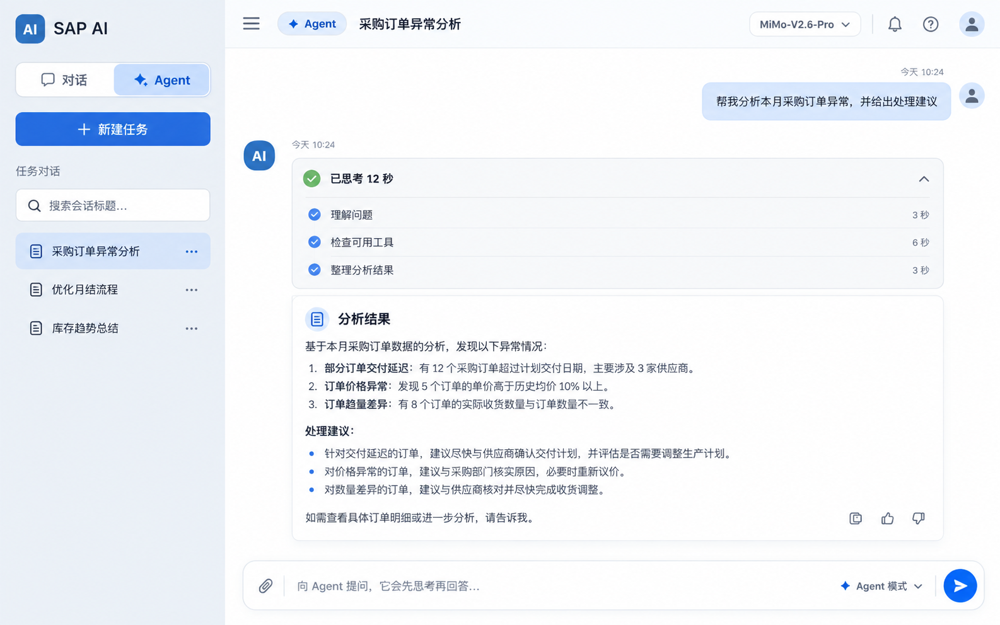

# AI 对话助手：通用 Agent 对话化改造开发计划

> 版本：V1.1
>
> 日期：2026-09-27
>
> 状态：设计评审稿（确认后交由 ZCode 开发）
>
> 对应设计图：`功能计划书/assets/对话与通用Agent模式_UI设计图_V1.1_20260927.png`



## 1. 本次修正结论

当前 V12 已经完成“对话 / Agent”的会话级分离，但把 Agent 设计成了“先选择一个具体 Agent，再创建任务”。这和目标产品形态不一致。

本次改造确定为：

1. 左侧仍保留“对话”和“Agent”两个工作模式，但按钮改成紧凑的横向分段按钮。
2. Agent 模式不再展示“库存分析”“更多 Agent”等 Agent 类型卡片。
3. 点击 Agent 后直接进入和普通对话一致的聊天界面。
4. Agent 模式下，用户发送任何问题都必须经过 Agent 编排流程：理解问题、制定步骤、判断是否需要工具、执行或检查、整理回答。
5. 库存查询只是 Agent 可选用的一组工具，不再是一个需要用户选择的 Agent 类型。
6. Agent 页面可以展示“正在思考 / 已思考”和安全的过程摘要，但不能展示模型内部思维链原文。

一句话定义：

> **对话模式是直接上下文问答；Agent 模式是始终先规划、按需使用工具、检查后再回答的通用对话。**

## 2. 现有实现与目标的差异

| 位置 | 当前实现 | 目标实现 |
|---|---|---|
| 模式按钮 | 两个面积较大的纵向按钮，选中态边框过重 | 一个横向分段控件，两个等宽选项，选中态使用柔和蓝色底 |
| Agent 首页 | 显示 Agent 类型卡片 | 不显示类型卡片，直接进入空白聊天页 |
| Agent 创建 | `_createAgentTask("INVENTORY")` | 创建通用 Agent 会话，不要求选择类型 |
| Agent 定位 | 库存分析 Agent | 通用 Agent；库存能力变成工具之一 |
| Agent 输入 | “描述你要完成的任务” | 普通聊天式输入，可询问任何问题 |
| Agent 流程 | 库存专用受限工具循环 | 所有问题先规划；有匹配工具则执行，无工具也要完成分析和回答 |
| Agent 标识 | `Agent · 库存分析` | 仅显示 `Agent` |
| 历史 | 任务历史并带类型 | Agent 会话历史，不展示具体 Agent 类型 |

## 3. UI 设计规范

### 3.1 对话 / Agent 模式按钮

按钮位于左侧品牌区下方，使用一个分段控件容器：

```text
┌────────────────────────────┐
│   💬 对话   │   ✦ Agent   │
└────────────────────────────┘
```

视觉要求：

- 两个选项横向排列、等宽、高度 44–48px。
- 外层只有一层浅灰蓝边框和轻微阴影。
- 选中项使用浅蓝到中蓝的柔和背景，文字使用深蓝色。
- 未选中项为白色或透明背景，文字为深灰色。
- 圆角 12–14px。
- 禁止使用当前截图中的双描边、强发光、厚蓝边框。
- 禁止将两个模式做成上下两张大卡片。
- 图标与文字左间距、两个按钮的内边距保持一致。

建议 CSS：

```css
.modeNav {
  display: flex;
  flex-direction: row;
  gap: 0.25rem;
  padding: 0.25rem;
  border: 1px solid #d9e2ec;
  border-radius: 0.875rem;
  background: rgba(255, 255, 255, 0.78);
  box-shadow: 0 0.125rem 0.5rem rgba(15, 45, 80, 0.05);
}

.modeNavBtn {
  flex: 1;
  min-width: 0;
  height: 2.75rem;
  border-radius: 0.6875rem;
}

.modeNavBtn.modeNavActive {
  background: #dbeafe;
  color: #0757b7;
  box-shadow: inset 0 0 0 1px rgba(10, 110, 209, 0.12);
}
```

实际 UI5 渲染会生成内部 `.sapMBtnInner`，ZCode 需要把背景、边框和圆角应用到正确的内部节点，避免外层和内层同时出现边框。

### 3.2 Agent 模式首页

删除 Agent 类型选择首页。用户点击“Agent”后，直接显示统一聊天空状态：

```text
                    ✦
            今天想让 Agent 做什么？
       Agent 会先思考，再按需使用可用工具

  ┌───────────────────────────────────────┐
  │ 向 Agent 提问，它会先思考再回答…       │
  │                                       │
  │  📎                        Agent 模式 ➤ │
  └───────────────────────────────────────┘
```

Agent 空状态不出现以下内容：

- “选择一个 Agent”；
- “库存分析”；
- “更多 Agent（规划中）”；
- Agent 类型卡片；
- 需要用户理解的技术性工具名称。

### 3.3 Agent 对话页

Agent 和对话模式共用同一套消息列表、用户气泡、回答区域和底部输入框。

差异只体现在：

- 顶栏模式徽标显示 `✦ Agent`。
- Agent 回答前展示运行状态。
- Agent 回答可包含折叠的过程摘要。
- 输入框右下角显示 `Agent 模式` 提示。

Agent 回复结构：

```text
AI

⌄ 已思考 12 秒
  ✓ 理解问题
  ✓ 检查可用工具
  ✓ 整理分析结果

最终回答正文……
```

运行中状态：

```text
◌ 正在思考…
  正在理解问题
```

调用工具时可更新为：

```text
◌ 正在执行…
  正在查询库存数据
```

不能显示：模型内部逐字推理、完整系统 Prompt、完整工具参数、SQL、访问令牌或未脱敏的原始结果。

## 4. 两种模式的最终行为

| 行为 | 对话模式 | Agent 模式 |
|---|---|---|
| 会话上下文 | 保留 | 保留 |
| 普通问答 | 直接回答 | 先规划再回答 |
| 是否每次进入思考流程 | 否 | 是 |
| 工具调用 | 默认不调用 | 按问题和权限自动选择 |
| 没有匹配工具 | 正常回答 | 通过分析完成回答，不能假装执行了工具 |
| 过程状态 | 不显示 | 显示安全摘要 |
| 最终回答 | 普通回复 | 检查后的回复 |
| 会话历史 | 对话历史 | Agent 会话历史 |
| 角色 | 支持 | 暂不支持角色前缀 |
| 附件 | 支持 | 建议支持；附件作为任务上下文，不直接当工具指令 |

## 5. 通用 Agent 运行流程

Agent 模式下每一条用户消息都执行同一套有限状态机：

```text
RECEIVED
   ↓
UNDERSTANDING      理解用户目标和当前会话上下文
   ↓
PLANNING           生成可执行的内部计划，至少执行一次
   ↓
TOOL_DECISION      判断是否需要、允许且存在匹配工具
   ├─ 不需要/无工具 → COMPOSING
   └─ 需要且可用   → EXECUTING → VERIFYING
                              ↓
                           COMPOSING
                              ↓
                           COMPLETED
```

必须遵守：

1. Agent 模式每次都经过 `UNDERSTANDING` 和 `PLANNING`。
2. “思考”不等于一定调用工具。
3. 只有注册表中的工具可以被执行。
4. 找不到工具时，Agent 应说明能力边界，并提供可完成的分析、方案或需要补充的信息。
5. 工具失败时允许在轮次上限内调整一次；不能无限循环。
6. 最终回答前执行一次完整性检查。

建议首期限制：

```text
最大 Agent 轮次：4
最大工具调用：4
单次总预算：60 秒
计划修复重试：1 次
工具结果回填：先摘要，再进入模型上下文
```

## 6. 后端架构调整

### 6.1 `AnalyzeAgent` 从库存入口升级为通用入口

保留现有接口名称以降低前后端改动：

```text
POST /AnalyzeAgent(SessionId, Question, ModelId)
```

但内部逻辑由“固定注入库存知识卡”改为：

```text
通用 Agent System Prompt
  + 当前 Agent 会话历史
  + 可用工具的精简 Schema
  + 按意图选中的领域知识卡（可选）
  + 当前用户问题
```

库存问题识别后，再加载库存领域卡和库存工具。普通写作、解释、总结、方案设计等问题不加载库存工具，也能走完整 Agent 流程。

### 6.2 工具不等于 Agent 类型

现有：

```text
AgentType = INVENTORY
→ 进入库存 Agent
```

改为：

```text
Mode = AGENT
→ 进入通用 Agent 编排器
→ 根据问题选择 0..N 个工具
```

首期可用工具仍然只有库存工具，但这不限制 Agent 只能回答库存问题。

### 6.3 通用输出协议

模型与后端之间继续使用严格 JSON，建议扩展为：

```json
{
  "action": "tool",
  "summary": "需要查询指定工厂的库存数据",
  "tool": "get_stock_snapshot",
  "args": {
    "plant": "0001",
    "material": "A001"
  }
}
```

不需要工具时：

```json
{
  "action": "final",
  "summary": "已完成问题分析和回答组织",
  "answer": "..."
}
```

`summary` 是可展示的短摘要，不是思维链。后端必须限制长度并过滤敏感内容。

### 6.4 过程事件

建议 `AgentResult` 在现有字段基础上返回：

```json
{
  "Status": "OK",
  "Answer": "...",
  "ElapsedMs": 12000,
  "Rounds": 3,
  "TraceJson": [
    {"phase":"UNDERSTANDING","label":"理解问题","status":"OK","elapsedMs":1200},
    {"phase":"TOOL_DECISION","label":"检查可用工具","status":"OK","elapsedMs":800},
    {"phase":"COMPOSING","label":"整理分析结果","status":"OK","elapsedMs":10000}
  ]
}
```

如当前同步 OData 无法推送实时状态，首期可先在前端按阶段显示“正在思考”，请求完成后用返回的 `TraceJson` 替换为实际摘要。后续再评估轮询、SSE 或 WebSocket。

## 7. 会话和数据模型

### 7.1 保留 Mode，取消前端 AgentType 依赖

保留：

```text
MODE = CHAT | AGENT
```

`AGENT_TYPE` 字段为了兼容已有数据库可以继续保留，但新建通用 Agent 会话应写空值或 `GENERAL`，前端不得再依赖 `INVENTORY` 才能发送。

推荐：

```json
{
  "SessionId": "...",
  "Mode": "AGENT",
  "AgentType": "GENERAL",
  "Status": "IDLE"
}
```

旧的 `AgentType=INVENTORY` 会话仍按 Agent 会话打开，不需要迁移或删除。

### 7.2 状态语义

Agent 状态由“整段会话任务状态”调整为“最近一次运行状态”：

```text
IDLE       当前无请求
RUNNING    正在执行本轮消息
COMPLETED  最近一轮成功
PARTIAL    最近一轮部分成功或超时
FAILED     最近一轮失败
```

Agent 会话可以连续追问，不应因为一次 `COMPLETED` 就被当成不可继续的单次任务。

## 8. 前端代码改动清单

### 8.1 `webapp/view/App.view.xml`

1. `modeNav` 保留，改为横向布局。
2. `chatModeNav`、`agentModeNav` 保留，移除 UI5 `Emphasized` 造成的重描边，选中态统一由 CSS 控制。
3. 删除 `agentHome`、`agentCardField` 及 Agent 类型卡片区域。
4. Agent 模式空会话直接复用 `hero`。
5. `heroTitle`、`heroSub`、输入占位符按模式绑定。
6. Agent 模式显示输入框右侧小标签 `Agent 模式`。
7. 消息模板增加 `thinkingSummary` 折叠区域。

### 8.2 `webapp/controller/App.controller.js`

删除或停用：

```text
agentHomeVisible
onNewAgentTask
_createAgentTask
_renderAgentCards
agentInfoVisible 中的 Agent 类型展示
```

修改：

- `_switchWorkspace("AGENT")`：没有历史会话时直接创建一个空的通用 Agent 会话，或进入通用 Agent 空状态。
- `onNewSession()`：当前为 Agent 模式时直接创建 `Mode=AGENT, AgentType=GENERAL` 会话，不跳类型选择页。
- `_setViewLayout()`：CHAT 和 AGENT 都复用 hero / message list / input dock。
- `_applyWorkspaceChrome()`：顶栏只显示“对话”或“Agent”，不拼接“库存分析”。
- `_sendAgentTask()`：改名为 `_sendAgentMessage()`，语义从单次任务改为连续对话消息。
- `_loadHistoryFor()`：Agent 用户消息不必统一标成“任务目标”，普通后续追问仍按用户消息展示。
- `_updateAgentSessionStatus()`：更新最近一轮运行状态，不锁定会话。

### 8.3 `webapp/service/ChatService.js`

保留：

```js
sendByMode({ mode, sessionId, question, modelId })
```

调整：

- `mode=AGENT` 时不再要求 `agentType=INVENTORY`。
- `sendAgent()` 的注释和 Mock 数据改为通用 Agent。
- Mock Agent 对任何问题都返回思考过程摘要；只有库存问题才模拟库存工具调用。

### 8.4 `webapp/css/style.css`

- `modeNav` 改为横向分段控件。
- `.modeNavBtn .sapMBtnInner` 清除默认强调按钮的蓝色实心背景和双边框。
- 添加 `.agentThinkingCard`、`.agentThinkingHeader`、`.agentThinkingStep`、`.agentModeHint`。
- 移除不再使用的 `.agentHome`、`.agentCardField`、`.agentTypeCard` 样式。
- 移动端小于 600px 时仍保持横向等宽，不改回上下堆叠。

### 8.5 `webapp/i18n/i18n.properties`

删除或停用：

```text
agentHomeTitle=选择一个 Agent
agentHomeSub=...
agentTypeInventory=库存分析
agentCardInvDesc=...
agentCardMoreTitle=...
agentSessionCreated=已创建库存分析任务
```

新增：

```properties
agentHeroTitle=今天想让 Agent 做什么？
agentHeroSub=Agent 会先思考，再按需使用可用工具
agentInputPh=向 Agent 提问，它会先思考再回答…
agentModeHint=Agent 模式
agentThinking=正在思考…
agentThoughtDone=已思考 {0} 秒
agentPhaseUnderstand=理解问题
agentPhaseTools=检查可用工具
agentPhaseExecute=执行所需操作
agentPhaseCompose=整理回答
newAgentSession=新建任务
histAgent=Agent 会话
```

## 9. 后端代码改动清单

### `backend-abap/ZCL_AI_AGENT_SERVICE.abap`

- 将库存专用 system prompt 拆成“通用 Agent 基础 Prompt + 可选领域卡”。
- 每轮先执行规划输出协议。
- 非库存问题允许 `action=final`，不能因没有库存槽位而报错。
- 只有命中库存意图时加载库存工具定义。
- 会话历史按 Agent 会话上下文传入，并进行长度裁剪。
- Trace 返回阶段摘要，不返回内部推理文本。

### `backend-abap/ZCL_AI_DOMAIN_CARDS.abap`

- 领域卡从 Agent 身份改为按需知识和工具提示。
- 未命中领域时返回空卡，不阻塞通用 Agent。

### `backend-abap/ZCL_AI_TOOL_REGISTRY.abap`

- 保持工具白名单。
- 新增按意图或领域返回候选工具 Schema 的方法。
- 工具不存在时返回“无可用工具”，由 Agent 继续做文本分析。

### `backend-abap/ZCL_AI_AGENT_GUARD.abap`

- 增加 `summary` 字段长度和字符校验。
- 过滤工具参数、SQL、Prompt、凭据等不应进入前端 Trace 的内容。
- 保留最大轮数、参数 Schema、权限、超时和结果裁剪。

### `backend-abap/ZCL_ZAI_CHAT_DPC_EXT.abap`

- Agent 会话只校验 `Mode=AGENT`，不再强制 `AgentType=INVENTORY`。
- 兼容老会话中的 `INVENTORY`。

## 10. 安全和产品边界

“像 Codex 一样思考”在产品上应实现为可观察的状态和安全摘要，不应实现为展示完整思维链。

必须满足：

- 前端只展示阶段、工具友好名称、状态、耗时和结果摘要。
- 不展示完整模型推理过程。
- 不展示未脱敏的工具参数和原始结果。
- 通用 Agent 不能自动获得任意 SAP 表、任意 SQL 或写入权限。
- 当前只有库存只读工具时，其他业务问题可以分析和给出方案，但不能伪造“已查询系统”。
- 写操作未来必须加入明确确认、权限校验和审计。

## 11. 开发步骤

### P0：UI 修正

1. 模式按钮改为横向分段控件。
2. 删除 Agent 类型首页和卡片。
3. Agent 直接复用聊天 hero、消息列表和输入框。
4. 顶栏删除“库存分析”类型文案。
5. 增加 Agent 思考状态和折叠过程摘要样式。

### P1：前端行为修正

1. Agent 新会话直接写 `Mode=AGENT, AgentType=GENERAL`。
2. 删除选择 Agent 类型的控制器流程。
3. Agent 历史改为连续对话语义。
4. Mock 模式支持任意问题的 Agent 思考流程。

### P2：后端通用化

1. `AnalyzeAgent` 增加通用规划 Prompt。
2. 库存领域卡改为按意图加载。
3. 非库存问题可以正常完成 Agent 回答。
4. 增加安全过程摘要。
5. 完成超时、无工具、工具失败和普通问答测试。

### P3：体验增强

1. 如后端条件允许，增加实时阶段事件。
2. Agent 支持文本附件作为上下文。
3. 增加停止后端任务的真正取消能力。
4. 后续新增工具时直接注册，不新增 Agent 类型卡片。

## 12. 验收用例

| 用例 | 预期结果 |
|---|---|
| 点击“对话” | 进入普通聊天；模式按钮为轻量选中态 |
| 点击“Agent” | 直接进入 Agent 聊天，不显示任何类型卡片 |
| Agent 问“解释什么是安全库存” | 展示思考状态，不调用库存查询工具，直接给出解释 |
| Agent 问“帮我写一份月结优化方案” | 经过规划后给出结构化方案，不报“非库存问题” |
| Agent 问“查询 0001 工厂 A001 库存” | 自动选择库存工具，完成查询并展示安全过程摘要 |
| Agent 要求执行不存在的工具 | 明确说明当前无法执行，并给出可行替代方案，不伪造结果 |
| Agent 连续追问“为什么？” | 使用当前 Agent 会话上下文继续回答 |
| 打开旧 INVENTORY 会话 | 正常以 Agent 聊天方式打开，历史不丢失 |
| 刷新页面 | 恢复正确模式和当前会话 |
| 查看过程 | 只看到阶段摘要，不出现思维链、SQL、Prompt 或密钥 |

## 13. ZCode 实施约束

- 本期重点是修正产品模型，不要继续扩展 Agent 类型卡片。
- 不删除旧会话或旧 `AGENT_TYPE` 数据。
- 不重写普通对话链路。
- 不将“每次思考”实现为固定等待动画；必须实际调用 Agent 编排入口。
- 不要求每次都调用工具，规划后可以直接回答。
- 不把库存工具移除；将它降级为通用 Agent 的可选工具。
- 不在前端伪造工具执行成功。
- 不展示内部思维链。

## 14. 最终产品定义

```text
对话：像普通聊天助手，基于上下文直接回答。

Agent：界面仍是聊天，但每条消息都会先理解和规划，
       再决定是否调用已有工具，检查结果后给出回答。
```

用户只需要选择“对话”或“Agent”，不需要理解系统内部有哪些 Agent、知识卡或工具。
