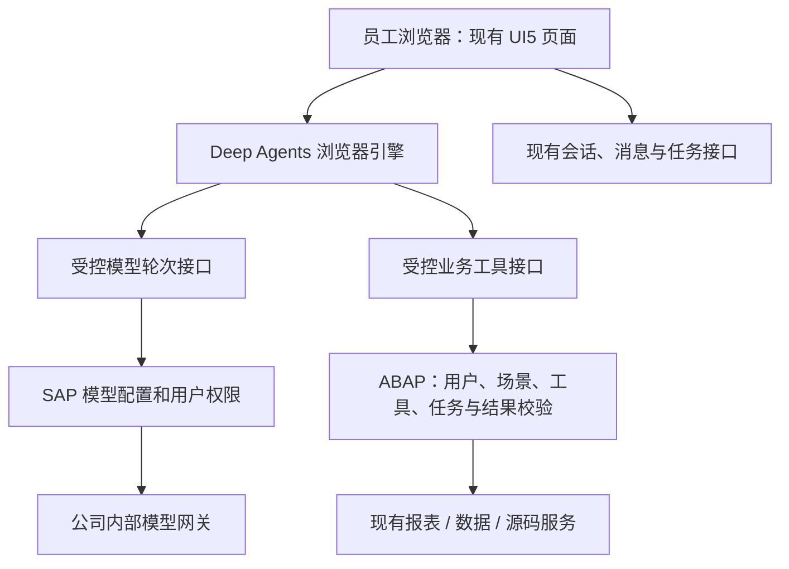

# 灵犀 Deep Agents 浏览器接入 —— 方案与开发计划

版本：V1.0  
编写日期：2026-11-07（Asia/Shanghai）  
状态：**方案草稿，待环境核实；本计划未实施、未在真实 SAP 测试库验证。**

> 本计划只描述后续开发，不代表已经安装 Deep Agents、修改业务代码、激活 SAP 对象或部署测试库。以实际测试库的对象版本、权限与部署结果为准。

---

## 0. 一页看懂

**目标**：在灵犀现有 UI5 页面中探索接入 Deep Agents 浏览器版，让 Agent 的模型与工具循环在用户浏览器中运行，同时继续通过 SAP 后端使用公司内部模型和现有 SAP 业务能力。

**使用条件**：员工电脑无管理员权限、不能安装软件、不能访问公网；公司内部模型和 SAP 测试库可由员工按现有网络与权限访问。这里将“员工电脑”与“开发构建机”分开：依赖在受控构建环境准备，员工只用公司已有浏览器打开 SAP 上的页面。构建机及内网导入流程仍需公司允许。

**建议技术路线**：Deep Agents JavaScript 的浏览器入口 `deepagents/browser` → 单独构建为 UI5 可加载的静态资源 → 随现有 BSP 应用发布 → 浏览器通过同源 SAP 接口调用模型和业务工具。浏览器入口排除了 Node.js 的本机文件系统、终端等能力，具体版本和实际依赖以 P0 验证为准。

**关键事实**：前端可以继续放在 SAP，员工电脑和 SAP 主机不需要为了这条浏览器路线新增常驻 Node 服务；但是要在开发构建阶段准备 Node 及依赖，SAP 后端也可能需要新增接口和类。能否真正运行取决于浏览器、安全策略、UI5 打包、模型工具调用协议和后端接口验证，**目前不能承诺只改前端或零 SAP 对象变更**。

**本期优先顺序**：P0 做隔离可行性验证 → P1 完成最小只读闭环 → P2 逐项接入报表和现有业务 → P3 补会话恢复与运营验收；本地文件操作列为 P4 单独推进。现有 ABAP Agent 在试点期间保留，是否切换由后续验收决定。

---

## 1. 现状、目标和范围

### 1.1 当前已有什么

| 位置 | 当前代码中的职责 | 对新方案的影响 |
|---|---|---|
| `webapp/service/ChatService.js` | `sendByMode`、`sendTask` 调用 `AnalyzeTask`，并处理会话、报表、进度等接口 | 新引擎需适配现有入口和返回数据，不能把页面切走后丢失参数卡、表格和任务状态 |
| `webapp/controller/App.controller.js` | 会话界面、过程轮询、停止、回答展示 | 复用界面，但 Deep Agents 事件到 UI 状态的映射需要新做 |
| `backend-abap/ZCL_AI_AGENT_SERVICE.abap` | 模型调用循环、场景路由、工具选择、参数检查、预算、任务与审计 | 这已经是现有 Agent 运行底座；浏览器循环不能简单再调用完整 `AnalyzeTask`，否则可能形成两层模型循环 |
| `backend-abap/ZCL_AI_LLM_CLIENT.abap` | 根据 SAP 模型配置调用企业网关，当前请求 `stream = false` | 现有聊天方法不是已验证的通用工具调用代理，需要扩展或另做受控接口 |
| `backend-abap/ZCL_AI_TOOL_REGISTRY.abap` / `ZCL_AI_AGENT_GUARD.abap` | 工具目录、参数和协议校验 | 后端执行入口要复用或抽取现有规则，并补足场景与跨请求控制 |
| `backend-abap/ZCL_ZAI_CHAT_DPC_EXT.abap` | 网关入口，已有 `ReportDefinitions`、`StartReportRun`、`ReportRunStatus`、`ReportResult`、Fiori 报表等 | 可按权限与任务归属复用；是否已在测试库发布，以 `$metadata` 和实际调用为准 |
| `backend-abap/ZCL_AI_TASK_SERVICE.abap` | 会话下的任务、上下文与结果归属 | 复用 SAP 任务事实；浏览器侧的临时状态不能代替后端归属校验 |
| `backend-abap/ZCL_AI_SKILL_SERVICE.abap` | 场景技能、工具范围、版本快照与审计 | 保留现有技能和权限交集；浏览器 SDK 的技能不自动等同于灵犀技能 |

当前已有的运行轮数、时间预算、模型兜底、任务追问、报表权限、Fiori 分析确认、技能工具交集和审计是功能基线，迁移时逐项对照。仓库代码版本不自动等于测试库已激活版本。

### 1.2 希望得到的效果

1. 普通聊天仍能正常使用；Agent 试点可以使用浏览器引擎。
2. 用户问“有哪些可用报表”，引擎通过受控 SAP 接口取得当前用户的目录并回答。
3. 同一会话中追问“刚才那张报表的参数是什么”，能继续理解前文；刷新后通过现有消息和任务事实恢复可见内容，具体恢复粒度在 P3 验证。
4. 在后续阶段选择已登记报表，用户确认参数，再复用 SAP 后台作业与结果查询。
5. 后续再评估用户授权的本地文件读取、预览和保存，不要求安装员工客户端。

### 1.3 本计划不把这些当作现成功能

- 不默认获得 SAP 全部工具、全部数据或所有文件的访问权；工具是否开放由 SAP 和公司策略决定。
- 不承诺真实逐字流式输出；模型网关、SAP 转发与前端显示均支持后才能提供。
- 不承诺浏览器关闭后 Agent 持续运行；SAP 已提交的后台报表可能继续，浏览器侧编排会中断。
- 不承诺浏览器 SDK 与 Node 版功能完全一致；浏览器入口不包含 Node 的本机文件系统及终端后端。
- 不将多 Agent、跨会话长期记忆、真实本地文件写入、MCP、定时任务重构列为 P0/P1 必做。
- 不将任何生产访问、正式发布或业务数据写入等同于本计划授权；按公司现有测试、变更及授权流程执行。

---

## 2. 目标架构与职责

**浏览器负责**：呈现聊天、调用引擎、处理用户交互、显示过程和维护本次运行的临时状态。浏览器内的数据、工具参数、用户身份字段、模型选择和任务编号一律只能视为请求，不是权限凭证。

**SAP 负责**：认证后的真实用户 `sy-uname`、用户开通与场景、工具及参数白名单、模型配置与密钥、任务／结果归属、执行限额、业务执行与审计。公司内部模型网关仍是实际模型服务。

**安全与并发原则**：前端按钮、提示词和 Deep Agents 的工具说明只是使用约束；用户可绕过前端直接请求接口，因此 SAP 每次执行都必须独立校验。浏览器携带的 `userId`、角色、工具清单、结果编号和限额不能作为放行依据。

**单一事实源**：SAP 继续是任务、报表作业、结果归属及业务授权的事实源；浏览器维护的 Agent 状态只能引用已验证的 SAP 编号。会话如何兼容既有消息，P1 先确定一处写入入口，避免同一轮对话重复落库。

---

## 3. P0：先证明能跑，再决定方案

P0 不连接生产数据、不依赖员工电脑安装软件；使用模型模拟器、工具模拟器或经批准的脱敏测试服务。产物为验证记录与具体版本清单，**不是生产部署包**。

| 验证项 | 做法 | 通过条件 / 未通过处理 |
|---|---|---|
| 浏览器入口与构建 | 在可构建环境固定 `deepagents`、LangChain、LangGraph 等版本和锁文件，使用 `deepagents/browser` 打包 | 浏览器运行 `createDeepAgent`，无 Node 专属模块、动态公网脚本或缺失依赖；失败则暂停浏览器路线 |
| UI5 加载 | 在现有 UI5 1.130 页面验证模块格式、异步加载、预加载与资源路径 | 本机 UI5 构建和实际 BSP 加载均可启动；记录包大小、首次加载时间和浏览器内存 |
| 员工实际浏览器 | 核对 Chrome / Edge 版本、公司策略、JS 特性、CSP 和实际访问容器 | 指定公司允许的浏览器通过；如果从 SAP GUI 内嵌窗口打开，单独检查其实际浏览器内核，不把 GUI 内嵌与外部浏览器当成相同环境 |
| 内网依赖 | 构建包在禁公网环境加载，检查开发依赖、资源、遥测、日志和模型地址 | 无未批准外网请求；记录依赖、许可证、来源与校验值，并检查精简发布包没有漏掉新资源 |
| 模型协议 | 用模拟网关验证结构化工具调用，再验证公司测试模型的 `tools`、`tool_calls`、多轮消息、错误和超时 | 能完整完成一次“模型→工具→模型”；如公司网关不支持，评估受控自定义适配与现有 JSON 协议，无法可靠适配则不推进 |
| 同源与身份 | 走 SAP 同源入口，验证登录、Cookie、CSRF、会话隔离及大请求 | 不在浏览器保存模型密钥；两位测试用户与匿名请求的身份、归属和拒绝行为正确 |
| 异常与停止 | 模拟模型超时、非法参数、工具失败、刷新和取消 | 有明确错误和状态；不把断线或取消当成已撤销 SAP 作业，不自动重复执行 |
| 实际访问安全上下文 | 查测试库真实页面 URL、证书及浏览器能力 | 本地文件操作如需直接保存，通常要求 HTTPS 与浏览器支持；P0 先记录事实，不能把文件能力通过等同于引擎通过 |

P0 同时核对测试库 `$metadata`、现有类版本、开关、SAP 版本、网关响应能力及上传方式。任何一项只在本地 mock 成功，都不能标记为 SAP 测试通过。

---

## 4. 前端设计

### 4.1 打包与加载

- 在可联网或公司允许的构建环境准备固定版本依赖，生成可离线部署的浏览器资源；不运行时从公网 CDN 取代码，不把密钥写进 bundle。
- 先做独立验证页，证明浏览器入口与 UI5 模块机制兼容，再接入正式控制器；按 P0 结果决定具体打包方式，不预设 npm 包可直接放进 BSP。
- 修改构建脚本时检查 `npm run build` 和 `npm run build:deploy` 的输出；精简包的过滤规则、文件路径和 `Component-preload.js` 必须经过资源完整性检查，防止本机可运行、上传后缺文件。
- 员工端不需要管理员权限或安装 Node。只有开发构建机需要相应工具；依赖是否可离线导入由公司流程确认。

### 4.2 接入现有聊天

- 在现有 `sendByMode` 之下增加引擎适配层：旧 ABAP Agent 与浏览器 Agent 各自实现统一的“发送、过程事件、结果、错误、停止”契约；普通对话继续走原有链路。
- 配置项先作为**候选方案**（例如 `BROWSER_AGENT_ON`，最终字段名、类型和存放位置待核对），默认关闭并限制测试用户。开关是试点控制，不是后端授权措施。
- 结果仍映射现有回答、Trace、任务、参数卡、表格与焦点结果。事件只展示可公开的阶段摘要和工具状态，不把密钥、原始提示词、敏感 SQL 或内部数据作为过程日志展示。
- 引擎故障要显示原因，并允许用户选择后续操作；**已经调用过工具、产生报表作业或无法确定执行状态时，不能自动重放到旧引擎**。关闭开关只影响之后的新请求，进行中的任务按原引擎完成或明确中断。
- 浏览器 Agent 停止仅能取消浏览器与支持取消的请求；SAP 已接收的调用和后台作业是否终止，以后端状态为准。切会话、刷新、断网和重复点击均要有明确状态。

### 4.3 本地文件：P4 可选

- 在支持的浏览器与安全上下文下，由用户主动选择文件或文件夹；网页只处理已授权范围，写回原文件需获得写入权限。浏览器可能要求重新授权。
- Deep Agents 的 `StateBackend` 是 Agent 的虚拟工作区，并不自动等于用户电脑的真实目录；要读写真文件须另外开发浏览器文件工具。
- 建议先做文本和 CSV 的读取、预览与另存，再评估 Excel 等格式的编辑保真；修改原文件应提供变更预览与用户确认。公司目录策略、文件占用、格式兼容和 HTTPS/GUI 内嵌浏览器需单独验证。
- 普通网页不能直接启动本机终端或 stdio MCP。之前工作区的 `local-mcp` 是独立 Node 进程，只提供报表目录、已有结果和 Fiori 目录的模拟联调原型，**不能直接在浏览器启动，也未接入本方案**。

---

## 5. SAP 接口与业务设计（接口名称均为候选）

P1 要先核对 SEGW、元数据和部署权限，再冻结字段。下列名称只是设计标识，不能当作已存在的接口。

### 5.1 启动运行与能力发现

候选 `BrowserAgentStart`：输入会话、场景、候选模型、用户问题或消息引用；SAP 检查用户已开通、会话和任务归属、场景与模型白名单，创建受控运行编号，返回服务端认可的能力列表和限制。

- `runId` 由 SAP 生成并绑定 `sy-uname`、会话、场景、模型、有效期、配额与状态；不接受前端自报身份或权限作为放行依据。
- 运行开启、超时、结束、并发锁、幂等与异常清理必须定义。是否复用 `ZAI_AGENT_RUN`、是否需要字段/表/锁对象，在 P0/P1 设计后决定；不要预设零 SE11 改动。
- 原 Agent 的工具范围、技能交集、模型白名单与 Fiori 用户确认条件均需对照保留。用户切场景或切会话时，SAP 重新核对；不能复用上一个用户或任务的能力列表。

### 5.2 受控模型轮次

候选 `BrowserAgentModelTurn`：浏览器发送运行编号、消息和当前轮次所需的结构化信息；SAP 在授权范围内选择模型配置，并转发到企业模型网关，返回规范化的文本、工具调用或错误。

- 不把模型密钥和内部网关凭据交给浏览器；不提供任意 URL、任意模型、任意 HTTP 请求的通用代理。
- 逐轮校验用户、运行状态、场景/模型、输入输出大小和预算。限制消息、工具定义和结果体积；输出截断或协议异常必须显式失败，不能执行残缺工具参数。
- P0 比较两条路径：① 网关原生结构化工具调用；② 在可靠测试和安全校验通过后，为现有严格 JSON 工具协议做适配。两条都不通过则停止本路线，不伪造兼容结论。
- 当前 `ZCL_AI_LLM_CLIENT` 构造的是非流式请求；第一版允许非流式。真正逐字输出需网关、SAP 中转、反向代理和浏览器全链路支持及实测。
- 现有 `ChatTexts` 的内容有长度上限、绑定当前用户，`resolve_text` 为一次性读取后删除；若复用其传递长模型请求，必须重新设计超限、失败重试、事务提交、过期和审计。不可假设同一引用可无限重试。

### 5.3 受控工具执行

候选 `BrowserAgentTool`：输入运行编号、工具编号、参数及请求编号；SAP 基于运行状态与当前用户重新确定能否执行，校验参数，再调用具体业务类，返回规范结果、错误与截断信息。

| 能力 | 建议接入顺序 | 实施要点 |
|---|---|---|
| 已登记报表目录 | P1 | 先用现有 `ReportDefinitions`，后端按用户筛选；不代表可以执行 |
| 用户已有报表结果 | P1/P2 | 复用 `ReportResult`，核对本人、有效状态与当前报表授权；核对结果完整性和后端行数上限 |
| 表结构、库存、源码 | P2 | 现有方法部分在 Agent 内部或业务类中，需抽取受控执行入口；保留场景、表、开发权限和源码隐藏规则 |
| 报表启动与状态 | P2 | 复用现有接口与后台作业；必须有属于当前用户/会话的 SAP TaskId，补充不依赖旧 Agent 模型循环的任务准备方案 |
| RFC / Fiori / 结果查询 / 联合分析 | P2 后逐项 | 保留登记白名单、执行限额、数据归属、Fiori 分析确认、结果完整性与现有业务规则 |

**不能只依赖前端限额**：原 Agent 循环中的执行次数和总预算若拆成多次 HTTP 请求，要由 SAP 按运行编号记录并原子检查，含失败、并发和重试。必要时通过 SAP 锁与持久状态落实；无法防绕过前不开放对应能力。

**幂等与副作用**：用户点击“执行报表”后生成请求编号；同一用户、任务、参数和请求编号的网络重试返回原运行，编号复用但参数不同应拒绝。超时/断线先查状态，不自动创建新作业。候选接口要复用原 `ClientRequestId` 语义并验证并发场景。

---

## 6. 上下文、会话和恢复

| 情况 | 首期行为 | 后续可扩展 |
|---|---|---|
| 同一轮工具调用 | 浏览器维护消息与工具结果；后端每次核验运行和结果归属 | 可按预算启用摘要，但摘要不是完整业务数据 |
| 同一会话多轮 | 复用现有会话消息、任务上下文和焦点结果 | 适配 Deep Agents 状态并记录版本 |
| 刷新页面 | 已保存的聊天、任务和 SAP 作业状态按现有能力重读；浏览器内未完成的 Agent 轮次标为中断或待核实 | 另行设计状态快照与手动恢复；禁止直接从摘要推断作业已执行 |
| 关闭页面 | 浏览器中的 Agent 停止；已提交的 SAP 后台作业按 SAP 状态运行 | 用户重新打开后查运行结果；不承诺网页关闭期间 Agent 自动继续 |
| 长对话 | 在模型预算内保留相关近期内容、任务摘要和结果引用 | Deep Agents 摘要需评估耗时、额外模型请求、细节丢失和数据处理边界 |
| 跨会话长期记忆 | **默认不启用** | 如有需求另定存储、用户隔离、可查看/删除和保留周期 |

结果查询、排名和合计必须以 SAP 返回的完整数据或后端统计为依据；如果只返回样例、达到行数上限或结果已过期，回答和界面必须明确说明，不能把摘要当作全量事实。Deep Agents 的存储能力需显式配置；浏览器内存不是可靠的跨刷新持久存储。

---

## 7. 迭代安排和交付

| 阶段 | 工作与交付 | 进入下一阶段的条件 |
|---|---|---|
| **P0 可行性** | 固定依赖；浏览器 bundle + 模型/工具 mock；验证 UI5/BSP、内网、网关协议和权限链 | 第 3 节全部关键条件有证据；失败则记录阻塞或选其他路线 |
| **P1 最小只读** | 独立试点入口/开关；受控模型轮次；报表目录工具；会话多轮和可见错误 | 两用户权限隔离、目录可用范围、模型工具闭环、旧引擎回归通过 |
| **P2 业务接入** | 分批接入已有结果、表结构/库存/源码、报表任务准备和后台作业；保留现有业务与安全约束 | 每批工具通过真实 SAP 测试库验收，覆盖跨用户访问、参数错误、配额与重试 |
| **P3 稳定与恢复** | 设计消息归属、状态保存、刷新恢复、异常可见、审计与离线发布 | 历史无重复、结果不串用户；异常重试不重复执行；回归和对照报告可复核 |
| **P4 文件能力（可选）** | 选文件/目录、读取、预览、授权写入、另存；先文本/CSV 后评估 Excel | HTTPS、浏览器策略、用户授权、格式保真与拒绝权限测试通过 |

本计划不指定工期或承诺某个版本的完成时间；先完成 P0，才能根据测试库权限、模型协议和实际开发工作量排期。

---

## 8. 验收与对照清单

使用公司批准的测试账号、模拟或脱敏数据；统一记录引擎版本、模型、配置、浏览器、请求编号和结果。先用现有灵犀跑基线，再在相同输入和模型下比较，不把模型回答看起来合理当成通过。

| 编号 | 场景 | 通过标准 |
|---|---|---|
| V01 | 禁公网环境加载 | 页面与引擎所需资源全部来自批准的内网；无运行时公网依赖 |
| V02 | 普通问题 | 使用批准的内部模型得到回答；未触发 SAP 业务工具 |
| V03 | 模型与工具循环 | 能发现并调用允许的报表目录，工具结果真实回填；失败显示真实错误 |
| V04 | 未授权/跨用户 | 未开通场景、别人的会话/任务/结果及禁用工具都被 SAP 拒绝，不能只靠界面隐藏 |
| V05 | 模型/工具注入 | 模型输出未经登记的工具名、非法参数、伪造用户/运行编号均拒绝，不暴露密钥 |
| V06 | 报表任务 | 未登记、无权限、参数不足时不提交；确认后真实测试作业仅创建一次 |
| V07 | 失败与恢复 | 超时、断网、刷新、重复请求、并发和浏览器关闭后状态如实显示，不将未知结果当成功或停止 |
| V08 | 准确性 | 结果超行数上限或仅部分数据时明确说明；筛选、排名、单位、金额与 SAP 基准结果核对 |
| V09 | 长对话 | 多轮追问引用正确任务和结果；超长内容不会错误串会话，摘要丢失时能如实说明 |
| V10 | 文件（P4） | 授权、拒绝、重新授权、预览、保存和浏览器不支持均有清晰结果；未授权不可读写 |
| V11 | 上线与回退 | 新旧入口、开关、SAP 接口、部署包版本、缓存和回退按第 9 节演练通过 |

安全拒绝类与防重复执行必须全部通过；其他指标记录实际通过率、耗时、模型调用次数、返回行数和失败案例。P0 未证明通道可用前，不设置凭空的提升百分比或性能承诺。

---

## 9. 测试库部署与回退计划

1. **先记录基线**：现有 BSP 名称与备份、`$metadata`、相关 ABAP 类与表版本、系统开关、当前通过的测试、模型和浏览器版本。保留现有 ABAP Agent。
2. **受控构建**：在构建机准备依赖、许可证清单、锁文件和产物校验；构建 UI5 完整包与精简包，在禁公网环境验证资源齐全。员工电脑不做安装。
3. **SAP 端实施**：如设计需要，按 SE11 → SE24 → SEGW → 网关注册/元数据刷新顺序执行，具体对象和顺序在实现后形成独立部署清单；老接口契约不得被破坏。
4. **前端试点**：优先使用独立 BSP 应用或受控测试入口，避免覆盖唯一可用页面；按现有 `/UI5/UI5_REPOSITORY_LOAD`、SICF 与缓存清理流程上传并核验。真实路径、传输请求和系统号以现场为准。
5. **验收后扩大**：默认走旧引擎，仅测试范围显式启用；逐项记录 V01–V11 证据与回归结果。
6. **回退**：停止接收新浏览器引擎运行，确认进行中的 SAP 作业状态；关闭开关并恢复原 BSP 包和原入口。新增接口可禁用，后端回滚依赖版本清单；已提交作业不会因为恢复页面被撤销。留存审计与必要结果，禁止通过重复提交来“恢复”。

测试库和生产库的部署均需遵循公司已有变更流程；本文件不包含真实账号、密码或模型密钥。

---

## 10. 待确认事项与决策记录

| 项目 | 当前理解 | 需要核实 |
|---|---|---|
| 用户环境 | 无管理员、不可安装、不可访问公网 | 浏览器品牌/版本、是否在 SAP GUI 内嵌窗口、CSP、HTTP/HTTPS 和企业策略 |
| 构建与发布 | 员工只接收 SAP 内网静态资源 | 哪台构建机可获取/导入依赖、审批流程、BSP 文件大小与数量限制 |
| 模型网关 | 公司内部、当前为 OpenAI 兼容聊天接口 | 工具调用、模型能力、流式响应、超时、数据上限、现有密钥管理 |
| 测试库真实状态 | 仓库包含相关 ABAP 和前端代码 | `$metadata`、激活版本、开关、授权用户、可用测试报表与结果 |
| 身份与任务 | 现有以 SU01 / `sy-uname`、任务及结果归属为基础 | 浏览器新接口能否沿用当前认证、跨请求锁和任务生命周期 |
| 存储与隐私 | 已有 SAP 会话、任务、结果和审计 | Agent 状态存哪里、保存多久、哪些内容可进模型、跨用户隔离与恢复粒度 |
| SAP 变更 | 可能新增模型代理、工具执行、任务准备接口 | SEGW/SE24/SE11/锁对象的最终清单，接口体积和性能限制 |
| 文件能力 | 用户选择并授权文件/目录 | HTTPS、浏览器版本、公司策略、Excel 复杂格式保真；P4 再决定 |

## 11. 参考资料

- [Deep Agents JavaScript 浏览器入口源码](https://github.com/langchain-ai/deepagentsjs/blob/main/libs/deepagents/src/browser.ts)
- [Deep Agents 官方概览](https://docs.langchain.com/oss/javascript/deepagents/overview)
- [Deep Agents 模型接入说明](https://docs.langchain.com/oss/javascript/deepagents/models)
- [LangGraph 状态保存说明](https://docs.langchain.com/oss/javascript/langgraph/persistence)
- [浏览器文件选择与安全上下文](https://developer.mozilla.org/en-US/docs/Web/API/Window/showOpenFilePicker)
- [现有 Agent 多业务开发计划](../Agent多业务任务与报表分析/01-开发计划_V1.0_20261007.md)
- [现有 Agent 实时过程约定](../Agent实时过程/01-边跑边看_接口约定与后端改造_V0.2_20261028.md)
- [现有前端部署说明](../../docs/04-前端实施文档.md)
- [现有 SAP MCP 原型说明](../../local-mcp/README.md)
