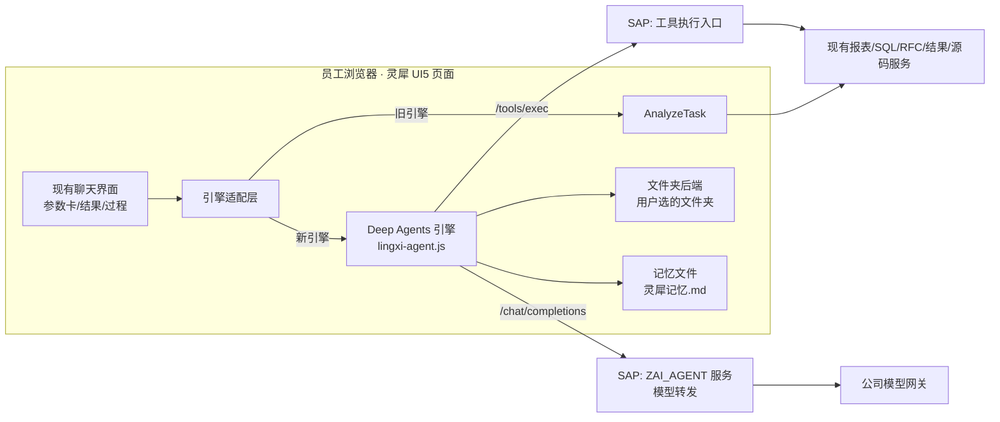

# 灵犀 Deep Agents 浏览器版 —— 方案与开发计划 V2.0

版本：V2.0（取代 V1.0 的方向部分；V1.0 中的安全、幂等、回退原则继续有效）
编写日期：2026-11-07
状态：**计划，未开工。** 本文中"已核实"指在仓库代码或 npm 包里看到的事实；SAP 测试库上的表现仍需按 M0 实测。

---

## 0. 一页看懂

**目标**：让灵犀具备类似 Claude Code / Codex 的能力 —— 会先列计划、能多步自主完成、过程可见、**能在用户选定的本地文件夹里读、改、新建文件**、有记忆。

**做法**：不推倒重写。在现有灵犀里**新增一套浏览器 Agent 引擎**（基于 Deep Agents JS 的浏览器入口），用开关切换；现有 ABAP Agent 保留为默认和兜底。会话、参数卡、报表、结果、权限全部复用现有实现。

**已经定下来的前提（11-07 与用户确认）**

| 前提 | 结论 |
|---|---|
| 访问方式 | SAP 已走 HTTPS → 浏览器的文件夹读写能力（File System Access API）可用 |
| 页面关闭 | 可以接受"页面关掉 Agent 就停"；已提交的 SAP 后台作业照常跑 |
| 员工电脑 | 不装任何东西；前端随现有 BSP 发布，从 SAP GUI / Edge 打开 |
| 最想要的能力 | 在文件夹里读改文件 + 记忆；这也是选 Deep Agents 而不是在 ABAP 里自研的主要理由 |
| 现有 Agent | 保留，试点期间默认仍走旧引擎 |

**仍未验证、M0 必须先测的**：SAP GUI 内嵌浏览器（WebView2）是否支持选文件夹和"每次访问时允许"；公司模型网关经 SAP 转发后 `tools` / `tool_calls` 是否完整；打包后在 UI5 1.130 里能否加载。

---

## 1. Deep Agents 带来什么、不带来什么

| 带来的 | 说明 |
|---|---|
| 计划 / 待办 | 内置 `write_todos`，开工前列计划，前端显示成清单逐项打勾 |
| 文件工具 | 内置 `ls / read_file / write_file / edit_file / glob / grep`，通过可替换的"文件后端"实现 → 接到用户选的文件夹 |
| 子 Agent | 内置 `task` 工具，把重活派给独立上下文，只拿回结论 |
| 上下文压缩 | 内置摘要中间件，对话变长时自动压缩 |
| 记忆 | 内置记忆中间件，可指定一个文件作为长期记忆（类似 CLAUDE.md） |
| 技能 | 内置技能中间件（Anthropic Skills 格式），可对接灵犀现有技能 |
| 不受 180s 总预算限制 | 每次模型调用、每次工具调用都是独立的短请求 |

| 不带来的 | 说明 |
|---|---|
| 口径正确 | "在制"等公司口径模型不知道，换框架也会算错 → 靠知识库 / 技能 |
| 更快 | 模型调用次数大约翻倍，复杂问题会更慢（瓶颈是模型输出速度） |
| 关页面继续跑 | 浏览器版做不到；已接受 |
| SAP 权限 | 所有业务权限、数据归属照样由 SAP 每次校验 |

---

## 2. 目标架构

**浏览器负责**：Agent 循环、计划、文件夹读写、记忆文件、界面。
**SAP 负责**：认证用户（`sy-uname`）、模型密钥与选择、工具白名单与参数校验、调用次数与配额、业务执行、审计、会话与任务的事实记录。
**原则不变**：浏览器发来的一切（工具名、参数、用户、任务号）都只是请求，SAP 每次独立校验。

---

## 3. 已核实的技术事实（2026-11-07）

| 项目 | 事实 | 影响 |
|---|---|---|
| npm 包 | `deepagents` 最新 1.16.3（11-06 发布），导出 `./browser` 入口 | 可用；版本迭代很快，**锁死版本** |
| 浏览器入口 | 导出 `createDeepAgent`、`StateBackend`、`StoreBackend`、`CompositeBackend`、记忆 / 技能 / 子 Agent / 摘要中间件 | 需要的能力都在 |
| 文件后端接口 | `ls / read / readRaw / write / grep / glob / delete`，可自己实现 | 文件夹后端按这个接口写 |
| Node 残留 | 浏览器入口的公共代码块仍 `import { createHash } from "node:crypto"`；还引用 `langsmith`、`@langchain/langgraph-sdk` | 打包时把 `node:crypto` 换成浏览器实现；确认 langsmith 不发任何外网请求 |
| 依赖 | 对等依赖 `langchain`、`@langchain/core`、`@langchain/langgraph`、`@langchain/openai` 等 | 都要打进同一个包；体积 M0 实测 |
| 现有模型调用 | `ZCL_AI_LLM_CLIENT` 不发 `tools`，`stream = false`，用自定义 JSON 协议 | 要新做一个 OpenAI 兼容的转发入口，原样透传 `tools` / `tool_calls` |
| 现有工具执行 | 写在 `ZCL_AI_AGENT_SERVICE=>analyze_agent` 主循环里（约 1280–2000 行一长串 IF） | 要抽成独立的"执行一个工具"方法，新旧引擎共用 |
| 现有工具 | 注册表 `ZCL_AI_TOOL_REGISTRY`：`search_tables / describe_table / run_sql / resolve_report / get_report_parameters / get_report_result / read_program_source / call_function / query_result` 及库存类工具 | 浏览器引擎通过统一入口调用，不重复实现 |
| 现有测评 | 管理员「Agent 测评」面板 + `webapp/model/evalCases.json`（29 题：DATA 12 / REPORT 5 / CODE 5 / AUTO 4 / INVENTORY 3）+ 打分逻辑 `utils/AgentEval.js` | M0 的考题直接扩充这个题库，新旧引擎跑同一套题 |

---

## 4. 前端设计

### 4.1 打包

- 新建 `agent-bundle/` 子工程（独立 `package.json` + 锁文件），用 esbuild 把 `deepagents/browser` 与依赖打成**一个文件** `webapp/lib/lingxi-agent.js`（ES2020，IIFE，挂到 `window.LingxiAgent`）。
- `node:crypto` 用别名换成浏览器实现（SubtleCrypto 或小型 sha256）；`langsmith` 的跟踪关闭，必要时用空实现替换，**构建后扫描产物，不得出现任何公网地址**。
- 这个文件不进 `Component-preload.js`，UI5 构建不再压缩；`build:deploy` 的精简包规则补上 `lib/lingxi-agent.js`。只多一个文件。
- 只在开关打开、用户第一次用新引擎时按需加载，不影响普通用户首屏。

### 4.2 引擎适配层

- 在 `ChatService.sendByMode` 下加一层：旧引擎走 `AnalyzeTask`，新引擎走 `BrowserAgent`。两者对外是同一个契约：发送 / 过程事件 / 结果 / 错误 / 停止。
- 新 mixin `webapp/controller/mixin/BrowserAgent.js`：创建 Agent、把 Deep Agents 的流式事件映射到现有"边跑边看"过程区（待办清单、正在调用的工具、子 Agent）。
- 工具结果里带报表参数卡、结果表时，复用现有 `AskCard` / 结果卡渲染，不另做一套。
- 开关：系统配置 `BROWSER_AGENT_ON`（默认关）+ 用户白名单；输入框旁加"新引擎"切换（仅白名单用户可见）。开关只是试点控制，不是权限。
- 新引擎出错时显示原因；**已经调过工具、提交过作业的轮次不自动改走旧引擎重跑**。

### 4.3 文件夹后端（核心）

- 用户点"选择文件夹" → `showDirectoryPicker({ mode: 'readwrite' })` → 文件夹把手存进 IndexedDB（只记是哪个文件夹，不存内容）。
- 刷新后取回把手，先查权限；没权限时显示"继续访问 XX 文件夹"按钮，用户点一下授权（新版 Chrome / Edge 可选"每次访问时允许"）。
- 实现 Deep Agents 的文件后端接口：路径一律限制在所选文件夹内（拒绝 `..`、绝对路径）；`grep / glob` 设文件数和大小上限，跳过二进制文件。
- **写之前自动备份**：原文件复制到 `.lingxi/备份/<时间>/`；同时往 `.lingxi/修改记录.md` 追加"时间 / 文件 / 改动摘要 / 对应的提问"。支持"撤回上一次修改"。
- 写入时机：Deep Agents 的人工确认中间件对 `write_file / edit_file / delete` 开启"改前确认"，界面显示改动对比，用户点"应用"才写入；用户可切换成"本次会话自动应用"。
- 文件被占用（如 Excel 正开着）时给出明确提示，不重试覆盖。
- 格式：第一版支持文本、CSV、JSON、Markdown；xlsx 用 SheetJS 读取，写入时**另存新文件**，不覆盖原件（格式可能丢失）。

### 4.4 记忆（三层）

| 层 | 存在哪 | 刷新后 |
|---|---|---|
| 对话 | 写进灵犀现有会话表（SAP） | 照常显示，可接着问 |
| 长期记忆 | 所选文件夹里的 `灵犀记忆.md`，用记忆中间件接入；Agent 开始时读、学到东西时写 | 跟着文件夹走，用户可直接查看、修改、删除 |
| 修改记录 / 备份 | 文件夹里的 `.lingxi/` | 可回答"上次改了什么"、可撤回 |

Agent 运行中间状态（做到第几步）第一版不持久化：中断后重新提问。

---

## 5. SAP 端设计

### 5.1 新增 ICF 服务 `ZAI_AGENT`（处理类 `ZCL_AI_AGENT_HTTP`）

用普通 SICF 节点而不是 OData：模型请求体是大 JSON，OData 函数导入不适合。挂在灵犀同一域名下，沿用现有 SAP 登录 Cookie。

| 路径 | 作用 |
|---|---|
| `POST /run/start` | 校验用户已开通、场景、模型白名单；生成 `runId`（绑定用户 / 会话 / 场景 / 模型 / 有效期 / 配额）；返回本次允许的工具清单（含 JSON Schema）和限额 |
| `POST /chat/completions` | OpenAI 兼容。按 `runId` 校验后，用 SAP 端模型配置（密钥不出 SAP）转发到公司网关，**原样透传 `tools` / `tool_calls`**；记调用次数和 token |
| `POST /tools/exec` | 按 `runId` + 工具名 + 参数 + 请求号执行一个工具；重新校验工具是否在本次允许清单内、参数、配额；返回规范结果 |
| `POST /run/finish` | 结束运行，写审计 |

- 防跨站请求：要求自定义请求头（如 `X-Lingxi-Agent: 1`）且校验 `Origin`；不接受浏览器自报的用户名。
- 每个 `runId` 的模型调用次数、工具调用次数、总 token 由 SAP 原子计数（新表 `ZAI_BRUN`），超限拒绝。
- 不提供任意 URL、任意模型的通用转发。

### 5.2 抽取工具执行入口 `ZCL_AI_TOOL_EXEC`

- 把 `analyze_agent` 里每个工具的执行分支抽成 `execute( iv_tool, iv_args_json, is_ctx ) RETURNING rs_result`，保留现有参数校验、工厂权限、结果截断、审计。
- 旧引擎改为调用这个方法，**行为不变**，用现有 ABAP 测试和测评题库做回归。
- 浏览器引擎通过 `/tools/exec` 调同一个方法。
- 报表执行仍走现有参数卡 + 后台作业 + `ClientRequestId` 幂等；Fiori 分析确认等用户确认流程保留。

### 5.3 对象清单（预计）

| 类型 | 对象 |
|---|---|
| SE11 | `ZAI_BRUN`（运行状态与计数） |
| SE24 | `ZCL_AI_AGENT_HTTP`（新）、`ZCL_AI_TOOL_EXEC`（新）、`ZCL_AI_AGENT_SERVICE`（改为调用 TOOL_EXEC）、`ZCL_AI_LLM_CLIENT`（加一个原样转发方法） |
| SICF | `/sap/bc/zai_agent` 节点 |
| 配置 | `BROWSER_AGENT_ON`、`BROWSER_AGENT_USERS`、每次运行的调用上限 |

---

## 6. 阶段安排

| 阶段 | 内容 | 完成标准 |
|---|---|---|
| **M0 验证 + 基线**（约 2–3 天） | ① 在 GUI 和 Edge 里跑选文件夹的控制台测试；② 用 Node 脚本经 SAP 现有通道或直连测试网关，验证 `tools / tool_calls` 往返；③ 打出最小包，在单独测试 BSP 里加载；④ 扩充测评题库到 40–50 题（加"读改文件""多步分析"类），用旧引擎跑出基线 | 三项技术验证都通过；基线成绩有记录。任何一项不过就停下重新评估 |
| **M1 最小闭环** | 打包工程 + 引擎适配层 + `ZAI_AGENT` 服务（start / completions / exec / finish）+ `ZCL_AI_TOOL_EXEC` 抽取 + 只读工具（表结构、SQL、报表目录、结果查询）+ 待办清单显示 | 白名单用户能用新引擎完成只读分析；旧引擎回归全部通过；两用户权限隔离测试通过 |
| **M2 文件夹** | 文件夹后端 + 授权恢复 + 改前确认与对比 + 备份 / 修改记录 / 撤回 + 记忆文件 | 读改新建文件、撤回、拒绝授权、文件占用等场景都有清楚结果 |
| **M3 全量工具** | 报表执行（参数卡 + 后台作业）、RFC、Fiori、联合分析、技能对接、子 Agent | 每类工具在 SAP 测试库验收，含越权、重复提交、配额 |
| **M4 对比与切换** | 新旧引擎跑同一套测评题；整理对话持久化与刷新恢复 | 新引擎成功率不低于旧引擎，复杂题明显更好，才扩大范围或改为默认 |

不排工期；M0 结果出来后再估。

---

## 7. 验收要点

1. 禁公网：页面和引擎的所有资源、请求只到 SAP；产物里无公网地址。
2. 越权：伪造工具名 / 参数 / runId / 别人的结果号，全部被 SAP 拒绝。
3. 不重复执行：网络重试、刷新、重复点击不会多提交报表作业。
4. 文件：只能访问所选文件夹；改前有对比和确认；有备份可撤回；拒绝授权有提示。
5. 准确性：结果超行数上限或只是部分数据时明确说明。
6. 成绩：测评题库上新引擎 ≥ 旧引擎，记录轮数、耗时、模型调用次数。

---

## 8. 部署与回退

- 新引擎先用**单独的测试 BSP** 试点，不覆盖现在在用的页面。
- SAP 端顺序：SE11 → SE24（`ZCL_AI_TOOL_EXEC` 先上，并让旧引擎改用它 → 回归通过）→ 新增 `ZCL_AI_AGENT_HTTP` → SICF 激活。
- 回退：关 `BROWSER_AGENT_ON` 即全部回到旧引擎；`ZAI_AGENT` 节点可直接停用；`ZCL_AI_TOOL_EXEC` 抽取若有问题，恢复 `ZCL_AI_AGENT_SERVICE` 旧版本。
- 已提交的后台作业不会因回退被撤销。

---

## 9. 待确认

| 项目 | 需要谁 / 怎么确认 |
|---|---|
| GUI 内嵌浏览器能否选文件夹、能否"每次访问时允许" | 用户按控制台测试实测 |
| 公司组策略是否限制文件夹访问 | 实测；不行找 IT |
| 网关 `tools / tool_calls` 支持情况与超时 | M0 实测 |
| 新增 SICF 节点是否需要 Basis 审批 | 现场确认 |
| 文件夹里允许 Agent 改哪些类型的文件、是否必须每次确认 | 用户决定（默认：改前确认） |
| 记忆文件名和位置 | 默认 `灵犀记忆.md`，可改 |
